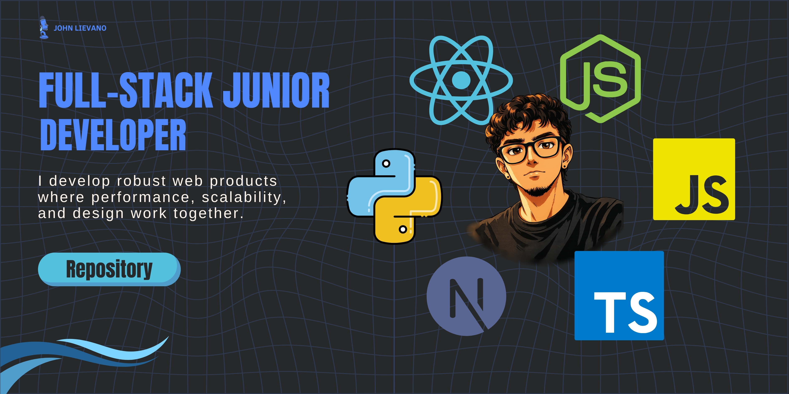

# Hi 👋, I'm John Esteban Liévano

  

> Paleta visual: `#2AA8FF` `#000000` `#61DAFB` `#F7DF1E`

---

### 🚀 Sobre mí

- 💼 Liderando proyectos de desarrollo web para pequeñas y medianas empresas, desde landing pages hasta plataformas corporativas.
- 💻 Más de 1 año de experiencia creando soluciones con un fuerte enfoque en **rendimiento y escalabilidad**.
- 🎓 Tecnología en Informática — Corporación Universitaria Minuto de Dios (6to semestre).
- 🌱 Aprendiendo continuamente sobre arquitectura moderna y buenas prácticas de código.
- 📫 Contáctame: johnlievanom@gmail.com

---

### 🛠️ Tecnologías y Herramientas

---

### 📌 Proyectos Destacados

| Proyecto | Tecnologías | Descripción |
|---|---|---|
| 🌐 [**Portafolio Profesional**](https://www.johnlievano.dev/) | React, TypeScript, Vite, Tailwind | Portafolio profesional multilingüe. |
| 🛍️ [**The Next Moda**](https://thenextmoda.com/) | E-commerce | Plataforma de comercio electrónico de moda. |
| 💍 [**VELO**](https://velo-frontend-alpha.vercel.app/) | Plataforma web | Gestión de bodas y eventos. |
| ☀️ [**Energías Renovables Polo a Tierra**](https://energias-renovables-polo-a-tierra-m.vercel.app/) | React, Tailwind, Vite | Sitio corporativo de energía solar. |
| 🌐 [**Áurea Web**](https://aurea-web.com/Index) | Desarrollo web | Sitio de servicios digitales y desarrollo web. |
| 🏢 [**Plataforma ERP Empresarial**](https://proposal-template-one.vercel.app/) | React, TypeScript, Next.js, Tailwind | Plataforma empresarial para gestión de usuarios y beneficios. |
| 📋 [**Sistema de Seguimiento**](https://prueba-tecnica-lilac.vercel.app/) | Aplicación web | Sistema de seguimiento y gestión. |
| ✈️ [**Aero Airlines**](https://github.com/johnlievano/flight-booking-platform) | Node.js, Express, Prisma, PostgreSQL, React | Sistema de reservas aéreas con selección de asientos y autenticación JWT. |

> 📂 Explora todos mis repositorios, tengo más proyectos en desarrollo activo.

---

### 📊 Estadísticas de GitHub

---

*"El código limpio no es una regla, es una forma de respetar a quien lo lea después — incluso si eres tú mismo en seis meses."*

